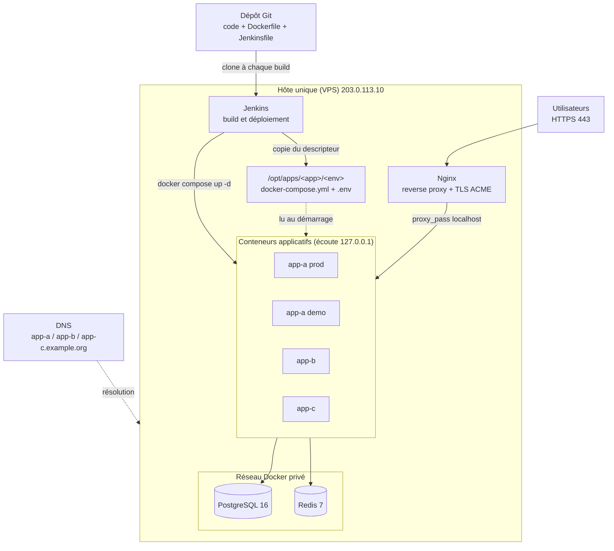
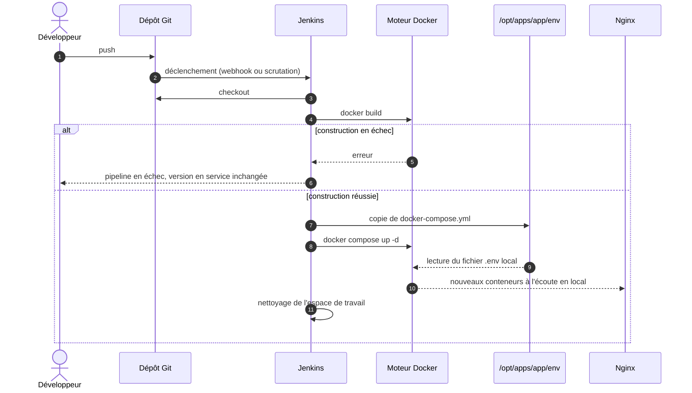
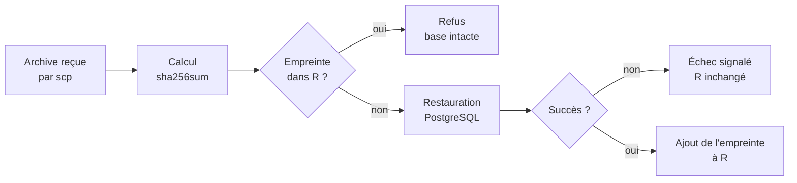

# Déploiement continu multi-applications sur un serveur unique : architecture de référence conteneurisée et garde d'idempotence par empreinte cryptographique pour la restauration des bases de données

<div align="justify">


**Auteur** : *APEDOH Kossi Kékéli Marc*¹
¹ *Institut Africain d'Informatique (IAI), Libreville, Estuaire, Gabon* — *apedohmarc5@gmail.com*

**Statut** : prépublication technique, non évaluée par les pairs. Version 1.0.
**Licence** : texte sous [CC BY 4.0](https://creativecommons.org/licenses/by/4.0/deed.fr) ; code des annexes sous licence [MIT](https://opensource.org/license/mit).

---

## Résumé

Les petites et moyennes organisations hébergent souvent plusieurs applications web sur un unique serveur privé virtuel (VPS), avec des déploiements manuels sources d'erreurs, d'écarts entre environnements et de fuites de secrets. Cet article décrit une architecture de référence qui combine un serveur d'intégration continue (Jenkins), un moteur de conteneurs (Docker) et un reverse proxy (Nginx) avec terminaison TLS automatisée (ACME / Let's Encrypt), pour déployer plusieurs applications sur un seul nœud. Trois règles structurent la conception : le code source ne réside que dans le dépôt de gestion de versions, les secrets ne résident que sur l'hôte cible, et seul le descripteur de déploiement (`docker-compose.yml`) transite du dépôt vers l'hôte. Nous proposons en outre une garde d'idempotence pour la restauration manuelle des sauvegardes : chaque archive est identifiée par son empreinte SHA-256 plutôt que par son nom de fichier, ce qui empêche la restauration répétée d'une même archive renommée. La démarche suit une méthode de recherche par la conception (*design science*). L'évaluation, qualitative, définit des tests reproductibles pour chaque propriété attendue ; l'analyse de la configuration met en évidence une limite de sécurité souvent ignorée : les ports publiés par Docker contournent le pare-feu UFW. Nous discutons les limites du nœud unique et proposons un protocole de mesure quantitative fondé sur les indicateurs DORA.

**Mots-clés** : intégration continue, déploiement continu, conteneurs, Docker, Jenkins, reverse proxy, gestion des secrets, SHA-256, idempotence, DevSecOps.

## Abstract

Small and medium-sized organisations frequently host several web applications on a single virtual private server, relying on manual deployments that cause human error, environment drift and secret leakage. This paper describes a reference architecture combining a continuous integration server (Jenkins), a container engine (Docker) and a reverse proxy (Nginx) with automated TLS (ACME / Let's Encrypt) to deploy multiple applications on one node. Three rules drive the design: source code lives only in the version control repository, secrets live only on the target host, and only the deployment descriptor travels from repository to host. We also propose an idempotence guard for manual database restoration that identifies each backup by its SHA-256 digest rather than its file name. Following a design science approach, a qualitative evaluation defines reproducible tests for each expected property, and configuration analysis highlights that ports published by Docker bypass the UFW firewall. We discuss single-node limitations and outline a quantitative evaluation protocol based on DORA metrics.

**Keywords**: continuous integration, continuous deployment, containers, secret management, SHA-256, idempotence, DevSecOps.

---

## 1. Introduction

L'intégration et le déploiement continus (CI/CD) sont désormais reconnus comme des pratiques qui améliorent la fréquence et la fiabilité des mises en production [1], [2], [3]. La littérature les étudie toutefois surtout dans des contextes d'infrastructures distribuées et d'orchestrateurs (Kubernetes, plateformes infonuagiques gérées) [4]. Une part importante des organisations de petite taille, en particulier dans des contextes à ressources contraintes, exploite au contraire un serveur unique hébergeant plusieurs applications et plusieurs environnements (production, démonstration).

Dans ce contexte, trois problèmes reviennent. Le premier est la dérive de configuration : les interventions manuelles successives rendent l'état du serveur impossible à reproduire [5]. Le deuxième est l'exposition des secrets : les fichiers de configuration contenant des identifiants sont fréquemment versionnés par erreur, et leur fuite à partir de dépôts publics est documentée à grande échelle [6]. Le troisième, moins étudié, concerne les opérations manuelles sur les données, comme la restauration d'une sauvegarde : rien n'empêche un opérateur de restaurer deux fois la même archive sous deux noms différents.

Cet article apporte trois contributions :

1. une **architecture de référence** minimale et reproductible pour le déploiement continu de plusieurs applications sur un nœud unique, fondée sur des composants libres et largement diffusés ;
2. une **règle de séparation** explicite entre code, descripteur de déploiement et secrets, avec la justification de chaque frontière ;
3. une **garde d'idempotence par adressage de contenu** pour la restauration des sauvegardes, formalisée et accompagnée d'une implémentation de référence.

La section 2 situe le travail dans la littérature. La section 3 décrit la méthode et l'architecture. La section 4 présente les résultats de l'évaluation, la section 5 les discute, et la section 6 conclut.

## 2. Travaux connexes

**Livraison continue.** Humble et Farley formalisent le pipeline de déploiement comme chaîne automatisée qui transforme chaque modification en version déployable [1]. Shahin *et al.* recensent, dans une revue systématique, les approches, outils et difficultés de la CI/CD, et soulignent le manque de travaux sur les contextes contraints [2]. Hilton *et al.* mesurent sur des projets libres les coûts et bénéfices de l'intégration continue [7]. Forsgren *et al.* relient les pratiques de livraison continue à quatre indicateurs de performance (fréquence de déploiement, délai de mise en production, taux d'échec des changements, temps de rétablissement), dits indicateurs DORA [3].

**Conteneurs.** Merkel présente Docker comme moyen d'obtenir des environnements cohérents entre développement et production [8]. Felter *et al.* montrent que le surcoût de performance des conteneurs Linux est faible au regard des machines virtuelles [9]. Sur le plan de la sécurité, Combe *et al.* analysent la surface d'attaque de Docker, notamment l'équivalence entre l'appartenance au groupe `docker` et un accès administrateur [10], et Shu *et al.* relèvent la prévalence de vulnérabilités dans les images publiques [11].

**Infrastructure as code et secrets.** Morris décrit la gestion de l'infrastructure par des fichiers versionnés [5]. Rahman *et al.* identifient sept catégories de « mauvaises odeurs » de sécurité dans les scripts d'infrastructure, dont les mots de passe codés en dur [12]. Meli *et al.* quantifient la fuite de secrets dans les dépôts GitHub publics [6]. La méthodologie *Twelve-Factor App*, issue de la littérature grise, recommande de stocker la configuration dans l'environnement d'exécution plutôt que dans le code [13].

**Chiffrement des échanges.** Le protocole ACME [14] et l'autorité Let's Encrypt [15] ont rendu gratuite et automatisable l'obtention de certificats TLS [16].

**DevSecOps.** Leite *et al.* [4] et Rajapakse *et al.* [17] synthétisent les difficultés d'intégration de la sécurité dans les chaînes DevOps, en particulier le manque de compétences et d'outillage dans les petites structures.

**Positionnement.** Nos composants sont connus. L'apport réside dans leur assemblage documenté pour le cas du nœud unique multi-applications, dans la règle de séparation code / descripteur / secrets, et dans l'application de l'adressage par contenu à la prévention des restaurations répétées. Des outils de migration de schéma comme Flyway [23] et Liquibase [24] enregistrent déjà des sommes de contrôle pour ne pas rejouer une migration ; nous transposons ce principe aux archives de sauvegarde restaurées manuellement, cas que nous n'avons pas trouvé traité dans les travaux cités.

## 3. Méthodologie

### 3.1 Démarche

Nous suivons la recherche par la conception (*design science research*) [18] : identification d'un problème pratique, conception d'un artefact (ici, une architecture et une procédure), démonstration dans un contexte réel, puis évaluation par rapport à des propriétés définies a priori. L'artefact a été déployé sur un VPS commercial hébergeant trois applications web et quatre noms de domaine. Les identifiants réels (adresses, domaines, noms d'applications) sont remplacés par des valeurs génériques ; l'adresse IP utilisée dans les exemples appartient à la plage réservée à la documentation [19].

### 3.2 Propriétés visées

| Id | Propriété | Formulation vérifiable |
| --- | --- | --- |
| P1 | Reproductibilité | Un déploiement ne dépend que d'un commit du dépôt et des fichiers `.env` de l'hôte. |
| P2 | Absence de code source persistant sur l'hôte | Après un déploiement, aucun fichier source ne subsiste en dehors de l'espace de travail éphémère du serveur CI. |
| P3 | Séparation des secrets | Aucun secret n'est présent dans le dépôt ; les fichiers `.env` ne sont lisibles que par les comptes autorisés. |
| P4 | Point d'entrée unique | Seuls les ports 80 et 443 sont joignables depuis Internet. |
| P5 | Isolation des applications | Chaque application dispose de son répertoire, de ses conteneurs et de sa configuration. |
| P6 | Idempotence de la restauration | Une même archive ne peut être restaurée qu'une fois, indépendamment de son nom. |
| P7 | Sécurité du déploiement en cas d'échec | Un échec de construction laisse la version en service inchangée. |

### 3.3 Environnement

| Composant | Version | Source |
| --- | --- | --- |
| Système d'exploitation | Ubuntu Server (LTS) | Image de l'hébergeur |
| Moteur de conteneurs | Docker CE, plugins Buildx et Compose | Dépôt APT officiel Docker, clé GPG vérifiée |
| Environnement Java | OpenJDK 21 (JRE) | Dépôt Ubuntu |
| Serveur CI/CD | Jenkins LTS | Dépôt APT officiel Jenkins, clé GPG vérifiée |
| Base de données | PostgreSQL 16 | Image `postgres:16` |
| Cache | Redis 7 | Image `redis:7-alpine` |
| Reverse proxy | Nginx | Dépôt Ubuntu |
| Certificats | Certbot + greffon Nginx | Dépôt Ubuntu, autorité Let's Encrypt |

### 3.4 Architecture

L'architecture comporte trois couches sur un seul hôte : une couche d'entrée (Nginx), une couche applicative (un ou plusieurs conteneurs par application) et une couche de services partagés (base de données, cache) reliée par un réseau Docker privé. Le serveur CI pilote le moteur Docker local.



*Figure 1 — Architecture de référence. Nginx est le seul composant exposé publiquement.*

L'arborescence de l'hôte sépare l'infrastructure partagée des applications :

```text
/opt/infrastructure/
├── postgres/     docker-compose.yml   (PostgreSQL)
└── redis/        docker-compose.yml   (Redis)
/opt/apps/
├── app-a/
│   ├── prod/     docker-compose.yml + .env
│   └── demo/     docker-compose.yml + .env
├── app-b/        docker-compose.yml + .env
└── app-c/        docker-compose.yml + .env
```

### 3.5 Règle de séparation code / descripteur / secrets

| Artefact | Lieu de résidence | Transit vers l'hôte | Justification |
| --- | --- | --- | --- |
| Code source, Dockerfile | Dépôt Git | Cloné dans l'espace de travail CI, puis supprimé | Une seule source de vérité ; rien à resynchroniser sur l'hôte (P1, P2) |
| `Jenkinsfile` | Dépôt Git | Lu par le serveur CI | Procédure versionnée et revue comme du code (P1) |
| `docker-compose.yml` | Dépôt Git | Copié dans `/opt/apps/<app>/<env>` à chaque build | Seul fichier nécessaire au moteur Docker pour (re)créer les conteneurs (P5) |
| `.env` (secrets) | Hôte uniquement | Jamais | Une fuite du dépôt n'expose aucun secret [6], [13] (P3) |
| Images | Moteur Docker de l'hôte | Construites sur place | Pas de registre à sécuriser dans la version minimale |

### 3.6 Pipeline de déploiement



*Figure 2 — Séquence d'un déploiement. Les conteneurs en service ne sont remplacés qu'après une construction réussie (P7).*

Un `Jenkinsfile` de référence est donné en annexe A.

### 3.7 Exposition et chiffrement

Chaque nom de domaine pointe vers l'adresse de l'hôte. Après vérification de la propagation DNS (`dig +short`), Certbot obtient un certificat unique couvrant tous les noms par le défi HTTP-01 du protocole ACME [14], et reconfigure Nginx pour HTTPS. Le renouvellement automatique est vérifié par `certbot renew --dry-run`. Le pare-feu de l'hôte (UFW) n'autorise que les ports 80 et 443 (profil `Nginx Full`) et le port SSH.

### 3.8 Garde d'idempotence pour la restauration

Les sauvegardes sont transférées sur l'hôte par `scp`, puis restaurées manuellement. Nous modélisons la garde comme suit. Soit $H$ la fonction SHA-256 [20], $f$ le contenu binaire d'une archive et $R$ l'ensemble des empreintes déjà restaurées sur une base donnée. La restauration est autorisée si et seulement si :

$$
H(f) \notin R
$$

Après une restauration réussie, $R \leftarrow R \cup \{H(f)\}$. Le nom du fichier n'intervient pas : deux fichiers de contenu identique ont la même empreinte. La résistance aux collisions de SHA-256 rend négligeable la probabilité que deux archives distinctes partagent une empreinte.



*Figure 3 — Garde d'idempotence par adressage de contenu (P6).*

L'empreinte n'est ajoutée qu'après succès, afin qu'une restauration interrompue puisse être relancée. Une implémentation de référence en Bash est donnée en annexe B.

## 4. Résultats

L'évaluation est qualitative. Chaque propriété est associée à un test reproductible et à un critère d'acceptation. Deux sources de résultats sont distinguées : l'**analyse statique** des fichiers de configuration, et l'**observation** sur l'hôte. Les observations ont été réalisées par l'auteur en [mois et année des essais]. Les tests marqués « à consigner » sont définis mais n'ont pas encore été exécutés à la date de cette version ; leurs résultats seront ajoutés dans une version ultérieure. Aucune mesure de performance ou de fréquence de déploiement n'a été collectée ; la section 5.4 propose un protocole pour le faire.

| Propriété | Test | Critère d'acceptation | Résultat |
| --- | --- | --- | --- |
| P1 | Supprimer les conteneurs d'une application, relancer le pipeline sur le même commit | Conteneurs recréés à l'identique | À consigner |
| P2 | `find /opt/apps -type f` après déploiement | Seuls `docker-compose.yml` et `.env` présents | Conforme par conception pour `/opt/apps` ; le code transite par l'espace de travail Jenkins, conformité complète conditionnée à `cleanWs()` |
| P3 | Recherche de `.env` et de mots de passe dans l'historique Git et les descripteurs | Aucun secret hors de l'hôte | Analyse statique : conforme pour les applications ; **non conforme** pour les descripteurs d'infrastructure initiaux (mots de passe en clair), correction par un `.env` dédié |
| P4 | Balayage des ports de l'hôte depuis l'extérieur (`nmap`) | Seuls 22, 80 et 443 ouverts | Analyse statique : **non conforme** dans la configuration initiale, base (5432) et outil d'administration (5050) publiés sur toutes les interfaces (voir 5.1) |
| P5 | Arrêter une application, vérifier la disponibilité des autres | Autres applications disponibles | Observé : conforme |
| P6 | Renommer une archive déjà restaurée et relancer la garde | Restauration refusée | Observé : conforme, l'archive renommée est refusée (cf. 3.8) |
| P7 | Pousser un commit qui casse la compilation | Pipeline en échec, conteneurs en service inchangés | Observé : conforme, la dernière version fonctionnelle reste en service |
| TLS | `certbot renew --dry-run` | Renouvellement simulé réussi pour tous les noms | Observé : conforme |

## 5. Discussion

### 5.1 Docker contourne le pare-feu de l'hôte

Le résultat le plus significatif pour la pratique concerne P4. Docker insère ses propres règles dans iptables pour les ports publiés ; ces règles sont évaluées avant celles d'UFW [21]. Une directive `ports: "5432:5432"` rend donc la base joignable depuis Internet même si UFW n'autorise que Nginx. La correction consiste à publier sur l'interface locale (`"127.0.0.1:5432:5432"`) ou à ne publier aucun port et laisser les applications joindre la base par le réseau Docker privé. Les outils d'administration (pgAdmin, interface Jenkins) doivent être servis derrière le reverse proxy, en HTTPS, avec restriction d'accès, ou atteints par tunnel SSH.

### 5.2 Privilèges du serveur CI

Ajouter le compte du serveur CI au groupe `docker` évite l'usage de `sudo` mais équivaut à lui accorder un accès administrateur à l'hôte [10]. Ce compromis est fréquent et acceptable sur un hôte dédié, à condition de durcir le serveur CI : authentification forte, mises à jour des greffons, accès réseau restreint. Le principe de moindre privilège [22] plaiderait pour un agent de construction séparé ou un mode Docker *rootless*, au prix d'une complexité accrue.

### 5.3 Portée et limites de la garde par empreinte

La garde identifie des **fichiers**, pas des **données**. Deux sauvegardes successives d'une même base, générées à quelques minutes d'intervalle, diffèrent octet par octet et ont donc des empreintes distinctes. La garde empêche le renvoi d'une même archive, erreur humaine la plus probable dans le scénario étudié, mais ne détecte pas la restauration de deux sauvegardes différentes d'une même source. Une protection au niveau des données relève des applications (contraintes d'unicité, journaux d'import). L'ensemble $R$ doit lui-même être protégé en écriture ; sa perte réautoriserait toutes les restaurations.

### 5.4 Validité et évaluation future

**Validité externe.** L'artefact a été démontré sur un seul hôte et trois applications ; la généralisation à d'autres piles logicielles est plausible mais non démontrée. **Validité interne.** Les tests ont été conduits par le concepteur de l'artefact, ce qui introduit un biais de confirmation ; une reproduction indépendante est souhaitable. **Évaluation quantitative.** Nous proposons de mesurer, sur une période d'au moins trois mois avant et après adoption, les quatre indicateurs DORA [3] à partir de l'historique des builds Jenkins et des incidents.

### 5.5 Point unique de défaillance

Le choix du nœud unique est économique mais concentre le risque : une panne de l'hôte interrompt toutes les applications et la chaîne de déploiement elle-même. Des sauvegardes chiffrées hors de l'hôte, testées régulièrement, sont un prérequis. Le passage à plusieurs nœuds relève d'un orchestrateur, hors du périmètre de cet article.

## 6. Conclusion

Nous avons décrit une architecture de référence pour le déploiement continu de plusieurs applications sur un serveur unique, fondée sur une séparation stricte entre code, descripteur de déploiement et secrets. L'analyse de la configuration met en évidence le contournement du pare-feu par les ports publiés de Docker, et le protocole de tests proposé permet de vérifier la reproductibilité, l'isolation et la sécurité en cas d'échec. La garde d'idempotence par empreinte SHA-256 prévient à faible coût la restauration répétée d'une même sauvegarde. Les travaux futurs porteront sur la mesure quantitative par les indicateurs DORA, l'ajout d'un registre d'images signé et l'automatisation complète des sauvegardes.

---

## Annexe A — `Jenkinsfile` de référence

```groovy
pipeline {
    agent any
    environment {
        APP_DIR = '/opt/apps/app-a/prod'   // répertoire cible sur l'hôte
        IMAGE   = 'app-a:prod'
    }
    stages {
        stage('Checkout') {
            steps { checkout scm }
        }
        stage('Build') {
            steps { sh 'docker build -t "$IMAGE" .' }
        }
        stage('Publish descriptor') {
            steps { sh 'cp docker-compose.yml "$APP_DIR/docker-compose.yml"' }
        }
        stage('Deploy') {
            steps {
                dir("${APP_DIR}") {
                    // le fichier .env est déjà présent sur l'hôte, jamais dans Git
                    sh 'docker compose up -d --remove-orphans'
                }
            }
        }
    }
    post {
        always { cleanWs() }   // aucun code source ne reste sur l'hôte
    }
}
```

## Annexe B — Garde d'idempotence (Bash)

```bash
#!/usr/bin/env bash
# restore-guard.sh <archive> <base>
# Restaure une archive PostgreSQL une seule fois, quel que soit son nom.
set -euo pipefail

ARCHIVE="$1"
DB="$2"
REGISTRY="/var/lib/restore-guard/${DB}.sha256"   # ensemble R, protégé en écriture

install -d -m 700 "$(dirname "$REGISTRY")"
touch "$REGISTRY"

HASH="$(sha256sum "$ARCHIVE" | cut -d' ' -f1)"

if grep -qx "$HASH" "$REGISTRY"; then
    echo "Refus : cette archive a déjà été restaurée (sha256=$HASH)." >&2
    exit 1
fi

# Restauration (format custom de pg_dump)
docker exec -i postgres pg_restore -U postgres -d "$DB" --no-owner < "$ARCHIVE"

# Ajout à R uniquement après succès (set -e interrompt le script en cas d'échec)
echo "$HASH" >> "$REGISTRY"
echo "Restauration effectuée, empreinte enregistrée (sha256=$HASH)."
```

Pour vérifier en plus l'intégrité du transfert, calculer `sha256sum` à la source, transmettre l'empreinte par un canal séparé et la comparer à celle calculée sur l'hôte.

## Annexe C — Extraits de configuration

**Service de base de données publié sur l'interface locale uniquement :**

```yaml
services:
  postgres:
    image: postgres:16
    restart: unless-stopped
    env_file: .env                       # POSTGRES_USER, POSTGRES_PASSWORD
    volumes:
      - postgres_data:/var/lib/postgresql/data
    ports:
      - "127.0.0.1:5432:5432"            # jamais "5432:5432" (contourne UFW)
    networks: [private-net]
volumes:
  postgres_data:
networks:
  private-net:
    external: true                       # créé une fois : docker network create private-net
```

**Bloc Nginx par application (avant passage de Certbot) :**

```nginx
server {
    listen 80;
    server_name app-a.example.org;

    location / {
        proxy_pass         http://127.0.0.1:8081;
        proxy_set_header   Host              $host;
        proxy_set_header   X-Real-IP         $remote_addr;
        proxy_set_header   X-Forwarded-For   $proxy_add_x_forwarded_for;
        proxy_set_header   X-Forwarded-Proto $scheme;
    }
}
```

**Droits recommandés :**

```bash
sudo chown -R deploy:jenkins /opt/apps
sudo find /opt/apps -type d -exec chmod 750 {} \;
sudo find /opt/apps -name '.env' -exec chmod 640 {} \;
```

---

## Références

[1] J. Humble et D. Farley, *Continuous Delivery: Reliable Software Releases through Build, Test, and Deployment Automation*. Addison-Wesley, 2010.

[2] M. Shahin, M. Ali Babar et L. Zhu, « Continuous Integration, Delivery and Deployment: A Systematic Review on Approaches, Tools, Challenges and Practices », *IEEE Access*, vol. 5, p. 3909–3943, 2017.

[3] N. Forsgren, J. Humble et G. Kim, *Accelerate: The Science of Lean Software and DevOps*. IT Revolution Press, 2018.

[4] L. Leite, C. Rocha, F. Kon, D. Milojicic et P. Meirelles, « A Survey of DevOps Concepts and Challenges », *ACM Computing Surveys*, vol. 52, n° 6, 2019.

[5] K. Morris, *Infrastructure as Code: Dynamic Systems for the Cloud Age*, 2ᵉ éd. O'Reilly, 2020.

[6] M. Meli, M. R. McNiece et B. Reaves, « How Bad Can It Git? Characterizing Secret Leakage in Public GitHub Repositories », in *Proc. NDSS*, 2019.

[7] M. Hilton, T. Tunnell, K. Huang, D. Marinov et D. Dig, « Usage, Costs, and Benefits of Continuous Integration in Open-Source Projects », in *Proc. IEEE/ACM ASE*, 2016, p. 426–437.

[8] D. Merkel, « Docker: Lightweight Linux Containers for Consistent Development and Deployment », *Linux Journal*, n° 239, 2014.

[9] W. Felter, A. Ferreira, R. Rajamony et J. Rubio, « An Updated Performance Comparison of Virtual Machines and Linux Containers », in *Proc. IEEE ISPASS*, 2015, p. 171–172.

[10] T. Combe, A. Martin et R. Di Pietro, « To Docker or Not to Docker: A Security Perspective », *IEEE Cloud Computing*, vol. 3, n° 5, p. 54–62, 2016.

[11] R. Shu, X. Gu et W. Enck, « A Study of Security Vulnerabilities on Docker Hub », in *Proc. ACM CODASPY*, 2017, p. 269–280.

[12] A. Rahman, C. Parnin et L. Williams, « The Seven Sins: Security Smells in Infrastructure as Code Scripts », in *Proc. IEEE/ACM ICSE*, 2019, p. 164–175.

[13] A. Wiggins, « The Twelve-Factor App », 2011. [En ligne]. https://12factor.net (littérature grise).

[14] R. Barnes, J. Hoffman-Andrews, D. McCarney et J. Kasten, « Automatic Certificate Management Environment (ACME) », RFC 8555, IETF, 2019.

[15] J. Aas *et al.*, « Let's Encrypt: An Automated Certificate Authority to Encrypt the Entire Web », in *Proc. ACM CCS*, 2019, p. 2473–2487.

[16] E. Rescorla, « The Transport Layer Security (TLS) Protocol Version 1.3 », RFC 8446, IETF, 2018.

[17] R. N. Rajapakse, M. Zahedi, M. A. Babar et H. Shen, « Challenges and Solutions When Adopting DevSecOps: A Systematic Review », *Information and Software Technology*, vol. 141, 106700, 2022.

[18] A. R. Hevner, S. T. March, J. Park et S. Ram, « Design Science in Information Systems Research », *MIS Quarterly*, vol. 28, n° 1, p. 75–105, 2004.

[19] J. Arkko, M. Cotton et L. Vegoda, « IPv4 Address Blocks Reserved for Documentation », RFC 5737, IETF, 2010.

[20] National Institute of Standards and Technology, *Secure Hash Standard (SHS)*, FIPS PUB 180-4, 2015.

[21] Docker Inc., « Packet filtering and firewalls », documentation officielle Docker Engine. [En ligne]. https://docs.docker.com/engine/network/packet-filtering-firewalls/

[22] J. H. Saltzer et M. D. Schroeder, « The Protection of Information in Computer Systems », *Proceedings of the IEEE*, vol. 63, n° 9, p. 1278–1308, 1975.

[23] Redgate, « Flyway », documentation officielle (validation des migrations par sommes de contrôle). [En ligne]. https://documentation.red-gate.com/flyway

[24] Liquibase, « Liquibase », documentation officielle (table DATABASECHANGELOG et sommes de contrôle). [En ligne]. https://docs.liquibase.com

</div>